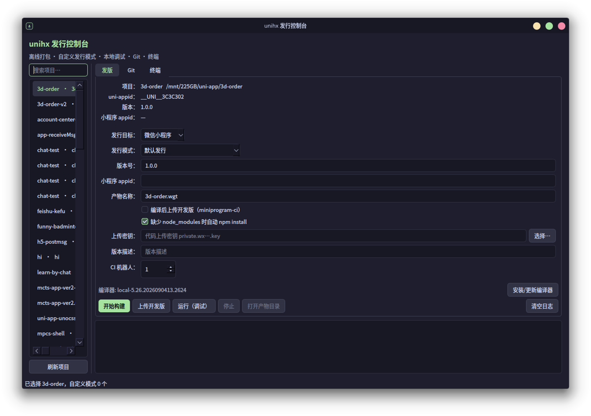

# unihx

[](https://github.com/hq520it/unihx/releases)
[](https://github.com/hq520it/unihx/blob/main/LICENSE)

> Build, debug and publish **uni-app** projects on Linux / macOS / Windows — **without HBuilderX**.
> 离线打包、本地调试、自定义发行模式，全部走官方编译器。



只封装 **uni-app 官方编译器（uni-cli）** 的跨平台构建工具：离线打包 + 本地调试。

> 不依赖 HBuilderX 图形界面，也不需要启动 HBuilderX 主进程。

## 特性

- **完全不需要 HBuilderX**：CLI 项目用 npm；老项目用「编译器插件包」（`uniapp-cli` + `node` + `compile-*`），`unihx update` 从官方包自动提取
- **离线打包**（纯本地编译，不走云打包）
  - `mp-weixin` 微信小程序
  - `app` App 资源（app-plus 产物）
  - `wgt` 离线升级包（app-plus 产物的 zip，与 HBuilderX 产物结构一致）
  - `h5` 网页
- **本地调试**：watch 增量编译 + 自动拉起微信开发者工具
- **自定义发行模式**：读取 `package.json` 的 `uni-app.scripts`（体验版 / 测试环境等条件编译）
- **编译器在线更新**：DCloud 官方 `release.json` 渠道，版本可切换
- **可选 GUI**：PySide6 桌面控制台（项目、发行模式、构建、Git）

## 平台支持

| 平台 | CLI | GUI | 说明 |
|---|---|---|---|
| Linux | ✅ | ✅ | 已实测 |
| macOS (Intel/Apple Silicon) | ✅ | ✅（终端复用 pty） | 待实机验证 |
| Windows | ✅ | ⚠️ 终端需 ConPTY | 待实机验证 |

> Windows/macOS 建议直接复用已安装的 HBuilderX（自动探测），无需下载编译器。

## 安装

**GitHub Release 安装（推荐，无需 PyPI）**

```bash
# 命令行（wheel 直接装）
pip install https://github.com/hq520it/unihx/releases/download/v0.1.0/unihx-0.1.0-py3-none-any.whl

# 含图形控制台
pip install "unihx[gui] @ https://github.com/hq520it/unihx/releases/download/v0.1.0/unihx-0.1.0-py3-none-any.whl"

# 或者下载后本地安装
pip install ./unihx-0.1.0-py3-none-any.whl
```

> 也可以直接下载源码包：`unihx-0.1.0.tar.gz`（Release 页面）

**源码安装（Linux / macOS）**

```bash
git clone https://github.com/<you>/unihx.git
cd unihx
./install.sh          # 命令行
./install.sh --gui    # 同时安装 GUI（需要 PySide6）
```

**Windows**

```powershell
git clone https://github.com/<you>/unihx.git
cd unihx
powershell -ExecutionPolicy Bypass -File install.ps1
# 然后把 %LOCALAPPDATA%\unihx\bin 加入 PATH
```

依赖：

- Python 3.9+
- node（编译器包内自带 `plugins/node`）
- 编译器来源二选一：
  - 已安装 HBuilderX：自动探测 `~/.local/opt/HBuilderX`
  - 或 `unihx update` 从官方渠道下载

## 运行到 Android 基座（实验）

```bash
unihx build --project ./my-app --target app --out /tmp/www
unihx android --project ./my-app --www /tmp/www

# 热更新：监听源码改动，自动重编译 + 推送到基座
unihx android --project ./my-app --watch

# 自定义基座：直接推资源到指定 app 的 www（需要可调试的自定义基座 APK）
unihx android --www /tmp/www --appid <appid> --base-package <package> --custom-base
```

- 自动 `adb reverse`、启动标准基座 `PullDebugActivity`、推送 wgt
- 不依赖 HBuilderX；协议见 `extras/android-push/README.md`
- **设备选择**：多设备时交互选择（非交互环境用 `--device` 指定），自动识别未授权/离线
- **基座检查**：启动前检查基座是否安装、版本是否与编译器匹配（如 5.26 ↔ 15.26），不匹配会提示
- **白屏修复**：app-plus 产物会自动加 `BROWSERSLIST="Android >= 4.4, ios >= 9, chrome >= 49"`，
  避免 `?.`/`??` 等新语法在旧 WebView（如 Chrome 74）上解析失败
- 旧设备（WebView 74）实测可正常渲染（见 `docs/assets/android-pda-es5.png`）

## 快速开始

```bash
unihx doctor                                  # 环境自检
unihx list-scripts --project /path/to/proj    # 查看自定义发行模式

# 离线打包
unihx build --project /path/to/proj --target mp-weixin
unihx build --project /path/to/proj --target app
unihx build --project /path/to/proj --target wgt --wgt-name app.wgt
unihx build --project /path/to/proj --target h5

# 带自定义发行模式（体验版）
unihx build --project /path/to/proj --target mp-weixin --script custom-platform

# 项目类型自动判定：
#   CLI 项目（package.json 含 @dcloudio/vue-cli-plugin-uni / vite-plugin-uni）→ npm run
#   HBuilderX 老项目 → 内置编译器直接编译（只读源码，不装依赖、不改 package.json）

# 本地调试：watch + 自动打开微信开发者工具
unihx run --project /path/to/proj --script custom-platform

# H5 开发服务器（热更新，默认 http://localhost:8080）
unihx serve --project /path/to/proj

# 项目没有 node_modules（HBuilderX 托管项目常见）时自动装依赖
unihx build --project /path/to/proj --target mp-weixin --install
```

产物位置（与 HBuilderX 一致）：

```
unpackage/dist/build/mp-weixin
unpackage/dist/build/app-plus
unpackage/dist/build/h5
unpackage/release/<name>.wgt
```

## 离线包格式

- `app` 目标产出 app-plus 资源目录（appResource 同源）
- `wgt` 目标 = 把 app-plus 产物打成 zip，条目在根目录
- 已实测：与 HBuilderX 生成的 wgt **文件列表完全一致**（56 个文件，2.7M）

## 自定义发行模式

```json
"uni-app": {
  "scripts": {
    "custom-platform": {
      "title": "微信小程序体验版",
      "env": { "UNI_PLATFORM": "mp-weixin", "UAT": true },
      "define": { "MY-MP-UAT": true }
    }
  }
}
```

`--script custom-platform` 会设置 `UNI_SCRIPT`，触发 `#ifdef MY-MP-UAT` 条件编译。

> 自定义模式的**平台由脚本的 `env.UNI_PLATFORM` 决定**（mp-weixin / h5 / app-plus），
> 会覆盖 `--target`。GUI 里选择自定义模式后会自动切换并锁定目标平台。

## 安装编译器插件包

老项目只需要一个自包含的编译器插件包（不需要安装 HBuilderX）：

```bash
unihx compiler install                  # 从官方包下载并只提取编译器插件
unihx compiler install --from-dir ~/.local/opt/HBuilderX   # 从已有 HBuilderX 复制
unihx compiler install --with-vite      # 额外带 vite 编译器（vue3）

unihx compiler list                     # 已安装版本
unihx compiler path                     # 当前使用的编译器
unihx compiler remove [--version xxx]   # 删除
```

安装后目录结构：

```
~/.local/share/unihx/compilers/<version>/plugins/
├── uniapp-cli
├── node
├── compile-less
├── compile-node-sass
└── compile-dart-sass
```

> 之后 `unihx build/run` 会自动使用它，不再需要 HBuilderX。

## 编译器在线更新

```bash
unihx update --check          # 只检查
unihx update                  # 下载并切换到最新版
unihx update --channel alpha
unihx update --with-vite      # 同时解压 vite 编译器
unihx versions
```

缓存：`~/.local/share/unihx/compilers/<version>`，`compiler` 软链（Windows 无权限时用指针文件）指向当前版本。

按平台自动选择官方包：

| 平台 | 包 |
|---|---|
| Linux | `linux_full_x64`（约 1.3G） |
| Windows | `win_simple`（约 204M） |
| macOS Intel | `mac_simple` |
| macOS ARM | `mac_simple_arm64` |

> 已装 HBuilderX 可直接复用，无需下载；也可 `--compiler /path/to/HBuilderX` 指定。

## 支持 vue2 / vue3

- vue2 / webpack 项目（如 HBuilderX 托管的老项目）：默认 `uniapp-cli`（webpack）
- vue3 / vite 项目：加 `--vite`（需编译器带 `uniapp-cli-vite`）

## 目录结构

```
bin/unihx         主程序（build / run / update / doctor / list-scripts）
gui/app.py        PySide6 图形控制台
assets/           图标、桌面文件
docs/             编译器说明、FAQ、逆向笔记（附录）
extras/hx-rpc     可选：直接驱动 HBuilderX 主进程（云打包/上传场景才需要）
install.sh        安装脚本
```

## 不包含

- HBuilderX Linux CLI（`cli`/`hbuilderx-cli`）的封装
- 云打包（APK 云端打包）、HBuilderX 登录态、uniCloud 部署
- 小程序「体验版」自动设置（普通账号无公开 API，需后台手动一步）

## 文档

- [docs/compiler.md](docs/compiler.md) — 编译器环境变量、自定义模式、离线包格式
- [docs/faq.md](docs/faq.md) — 常见问题
- [docs/reverse-engineering.md](docs/reverse-engineering.md) — HBuilderX CLI IPC 协议逆向（附录）

## 参与贡献

见 [CONTRIBUTING.md](CONTRIBUTING.md)。

## 免责声明

- 与 DCloud、微信官方无隶属关系
- uni-app 编译器由 DCloud 发布，本项目仅调用并按官方渠道更新，请遵守其许可
- 商标归各自所有者

## License

MIT
